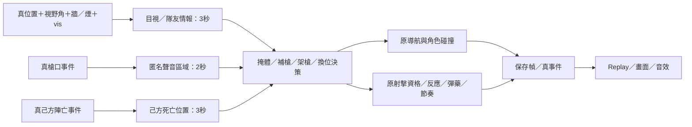

# Owner4H 設計與驗證方法

## H4：守包路徑預留與碰撞後復位（最終重驗中）

H3的新GPU情境不是全綠：Mirage真保存幀round2 t1持scout，在106.5秒抵達後被往房間深處走的t3擠走；110.5秒離原位置4.44m。逐幀記錄證實每次是角色separation，沒有敵情報或改點。守包路徑只避免終點重疊，沒有避免通過隊友已預留架點；routeIdx完成後亦不會從被推離的位置復位。原9/10 PRODUCT_FAIL及trace保留。

H4在原planFpsPostPlant候選路徑加同隊預留位置的線段距離檢查（2×1.35＋.3m），不讀隱藏敵人；允許角色離開已擁擠的起點，不能在後續路段重新進入。避免窄門後方隊友往架槍者身上推擠，不改身體碰撞半徑或穿牆規則。原既定點不每tick改選；沒有可達的合作架點時維持原有hold-until-reachable-angle。

fpsNeedsObjectiveRouteRecovery只對post-plant-hold／defuse-cover生效：距既定點超過原.55m且路徑已完成，從實際位置重新走原導航；在途／抵達／一般交戰不反覆重建。九個反例及接線斷言通過；同走廊原版選會穿隊友的點，新版拒絕。仍需完整Simulation／公平性及新版GPU重驗，不能據單元規則宣稱所有守包問題完成。

H4 freeze：e8d9b1ebf3bd1244372647a44ea6ce616ec257f0d4c1b1de76a3de8ffdaa5af4，144檔、相對G十個CS檔案變更。下列81ad84fd與數值為H3歷史，最終數字以OWNER4H_CLOSURE.md及final-source-freeze-r2.json為準。

## 版本與邊界

本輪以 Owner4G `cf3d243e…` 的141份產品／資產為起點；最終凍結版 `81ad84fd…`、144份。差異僅九個 CS/FPS 檔案（含三個新模組），其餘既有選手資料、音效、已驗收美術、Result／Replay契約與MOBA逐byte保持相同。完整檔案SHA見 `evidence/owner4h-review-20261018/final-source-freeze.json`。

這是局部修正；沒有換引擎、重寫導航、修改勝負／傷害／槍械射程／獎勵，或重新製作已通過動畫。

## 正式 AI 感知

- `visibleTo` 保留同一敵人的所有當下觀察者；本人當下目視優先於近處隊友舊回報。
- `canObserveFps` 只決定看得見：vis感知距離、視野角、致盲、牆與煙。拾槍、換彈、撤退或短射程槍不會使角色失明。一般感知沿用 `28 + effective vis × .28`；狙擊沿用既有長距離包絡。
- `canEngage`／排程仍決定打得到、何時能打；未改25／38／42／55／88的既有武器族射程，不藉情報直接開火。
- 普通槍聲44m，消音手槍16m，隔牆乘.58；回報4m／8m近似區域，不帶敵人id或即時追蹤。
- 陣亡線索只用己方死亡位置，32m內、3秒有效，不洩漏兇手位置。
- 補槍限26m內的真死亡／兇手情報鏈；眼前可見敵人先交戰，攜包責任保留。
- 掩體需近牆遮住中心及至少一側肩線（既有半徑1.35）；規劃避位只讀己方佔位。實際角色碰撞仍由原引擎執行。

## 拆彈因果

正式開始、持續與完成都接相同的 `knownBombThreat`：有TTL的己方目視／隊友回報，或真槍聲區域；牆／煙仍能隔絕威脅。公開擊殺資訊顯示敵方全滅時，不讓舊槍聲造成透視式中止。

接觸外框、樓層差、存活／致盲、足夠剩餘時間、個人rate、3.5進度門檻及到期判定維持原標準。中斷者放入本tick私有Set，不得同tick開槍後續接舊進度；下tick重新取得資格才能重來。不預寫拆彈或勝負。

原helper沒有傳入新回呼時保留舊行為，維持既有邊界工具相容；正式兩處接點皆有明確斷言，不能遺漏回呼退回舊的隱藏敵人判斷。

## 地圖與職業走位

保留所有牆、門洞、工作台／掩體、平台／坡度、角色半徑及可見美術。九間 authored room 的中心加入公開戰術節點，既有選點與真導航決定是否使用，沒有強制每職走同一路。

12個已設計室內皆驗出生點連通、有效入口與0.2m路徑碰撞取樣；裝飾實體建築不強行挖空。真GPU室內取樣只對實際有角色進入的保存幀計算OBSERVED，缺情境保留NOT_TRIGGERED。

五職／16能力、Rifler武器偏好、可自由同職陣容與成長資料沿用Owner4F／G。Entry進點、Lurker側線、Support道具、AWPer架槍、IGL協調等正式duty仍由既有系統執行；本輪增加可靠感知與掩體選項。

## 命中與分析圖層

- 血花必須同時有真 `muzzle.hit`、正傷害、真射擊時間與tracer／目標位置；不以HP差值或UI標籤補造命中。
- 原創32² alpha，共用一個材質／幾何；48個血跡及24個血滴，兩個InstancedMesh batch。非發光材質，沒有額外光源或後處理。
- 血花.18秒，環境血跡20秒；牆面只投到命中方向3.5m內第一個真實體表面，地面取同一floor sampler並依坡度對齊。
- 每回合索引真保存事件；重讀、暫停、倒帶與跨回合不重複累加，也不保留未來痕跡。減少動態保留原地命中訊息，取消血滴位移。
- 移除Major的抽象命中／死亡光圈。大型X原為舊版死亡定位的兩片交叉Plane；正常預設隱藏，只有「陣亡位置」分析開關顯示，POV不顯示。

## 鏡頭與資訊同步

桌機左拖平移、右拖旋轉、滾輪縮放、雙擊聚焦與重置。操作真canvas，維持目標、角度及距離界限。POV保留角色／狙擊鏡真狀態鎖定，不接受拖曳／滾輪改寫瞄準。

手機單指平移，雙指縮放／中心平移；390px原生CDP觸控僅代表瀏覽器模擬，不是手機真機驗證。

POV敵方名牌／血條也讀同一實牆／煙遮擋；cache只保留一個不可變保存幀及觀察者，不在每個RAF重跑射線，也不改AI。一般觀戰仍可看完整兩隊資訊。

## A/B 與判準

- 固定 Mirage／Dust2／Inferno × 505001／505002；起點六場與最終六場，原版124／新版127回合。中間H1／H2／H3證據保留，但不拿來冒充最終版。
- 房間使用量為「同回合、同角色、同房間」去重，非專業戰術成功率。actor sample為角色×0.5秒，非擊殺／交戰次數。
- 原公平性三圖三seed，base／換邊／兩次決定性重跑共36次；勝率只計18場獨立配對，重跑不重複計分。原abs round delta .08與paired effect .75聯合門檻不改。
- FPS以相同AMD硬體、1366、原畫質、1×順序A/B。保留原10秒開局／煙霧／真八煙Replay；另加相同保存幀POV與60秒跨回合壓力取樣。原median、p95、draw calls與triangles相對門檻不改。
- Replay維持256MiB wire／64MiB gzip；本次真6563幀30回合265,025,069 bytes wire、22,762,089 bytes gzip，逐幀／逐欄位／Result精確往返。未修改codec、丟幀或提高容量。

## 必須保留的限制

固定樣本不是所有seed／戰術／角度的保證；本次配對T46.65%／CT53.35%，不能宣稱全球無側偏。仍為簡化競技Simulation，不宣稱等同職業真人或完整CS2彈道／垂直視線模型。

真手機FPS、觸控及長時間遊玩仍待Owner；Replay接近既有容量上限，較長OT仍可能碰到原限制。歷史Owner4F-H1／H2／H3未過守門繼續具名保留，不將未執行或未觸發情境標PASS。最終GPU／FPS結果與原始失敗索引由OWNER4H_CLOSURE.md記錄。

## 最終收件

H4 source e8d9b1eb…完成工程收件；最新A/B為124→116回合、34→45安包、10→15拆彈、70→158房間到訪，公平性獨立350回合T51.43%／CT48.57%。原GPU、正式桌機／390及同AMD FPS完成；八煙原同程序尖峰另以三組獨立新Chrome複核，原紅燈與長時風險保留。Mirage第二種子真狙擊守包／拆彈4/4補齊。數值、完整失敗分類與來源均以OWNER4H_CLOSURE.md及engineering-complete.json為準；本文件上方H3／驗證中段落為歷史過程，不當最新版PASS。停Owner Review。
